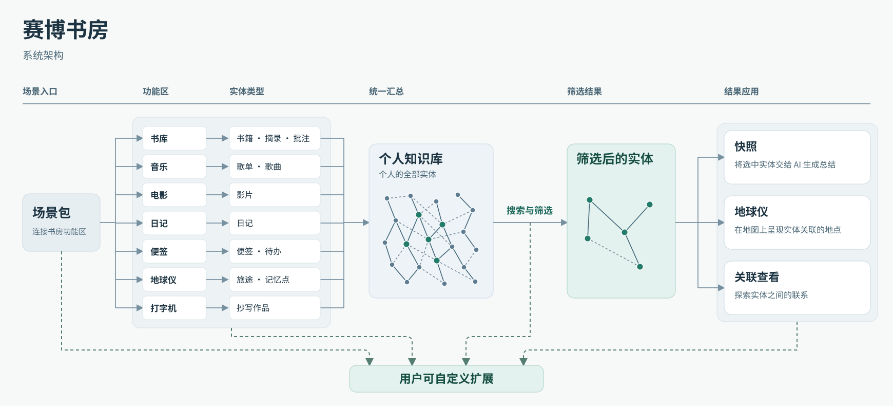

# 赛博书房的系统设计

赛博书房是一种以可交互场景为入口的个人知识管理系统。个人记录产生于阅读、观影、旅行等不同活动，其组织方式也随内容而异。随着记录积累，用户往往需要跨越原有功能区，围绕一个主题重新查找和组织材料。赛博书房为此建立统一的实体目录，并将场景交互、实体组织、筛选和结果应用串联起来。

如图 1 所示，系统由场景包、功能区、个人知识库、搜索与筛选以及结果应用五个部分组成。场景包提供功能入口，功能区负责各类内容的创建和管理，个人知识库汇总各功能区的实体。搜索与筛选将全库映射为与当前任务相关的实体集合，快照、地理视图与关联查看在这一集合上提供不同的处理方式。各环节可在遵循相应数据约定的前提下重新实现或扩展。

*图 1　赛博书房系统架构*

## 1. 场景包

场景包决定用户走进怎样的书房，以及如何从房间进入各个功能区。例如，点击书架进入书库，点击唱片机打开音乐，点击地球仪查看旅途与记忆点。场景制作人可以改变物件的位置、外观和交互热点，并把这些入口绑定到相应功能。

项目提供默认场景包，并定义了以 `scene.json` 为核心的场景包格式。配置描述模型资源、初始视角和可选的交互热点、灯光与声音。用户可以选择已有场景包，也可以遵循格式自制场景包，用自己的空间和物件接入书房功能。

当前 v1 格式以 GLB 模型和三维相机为基础。二维房间也是可扩展的呈现方式，例如用一张平面房间图和可点击区域连接同样的功能入口。原生二维场景可以通过扩展场景格式或加载器实现。场景的画面与功能入口可以重做，书籍、日记等记录仍由个人知识库统一管理。

## 2. 功能区

功能区让用户在熟悉的使用情境里创建、查看和整理内容。当前接入个人知识库的七个功能区共覆盖十二种实体类型。

### 2.1 书库

**总体功能**　书库支持导入、组织和阅读书籍。用户可在阅读时摘录原文，并为摘录添加自己的批注。回顾时，用户可以从笔记回到原文所在位置，将阅读记录与上下文一起查看。

- **书籍**是阅读的基本单位，保存书目资料、阅读内容及阅读进度。用户可以从书架打开书籍，也可以按书籍回顾积累的摘录。
- **摘录**保存用户选中的原文以及它在书中的位置。摘录可以独立进入知识库，供用户跨书查找和比较相关段落。
- **批注**保存用户针对摘录写下的解释、问题或联想。批注通过对应的摘录保留原文语境，同时作为独立实体参与检索。

### 2.2 音乐

**总体功能**　音乐区用于导入和整理曲目，在书房内浏览和播放个人收藏。用户可以按歌单集中收听，也可以把单首歌曲与其他内容关联起来，例如把旅途中听过的歌曲连接到一个记忆点。

- **歌单**按主题或使用场景组织多首歌曲，可用于保存和回顾一组曲目。
- **歌曲**记录单首曲目及其艺人、专辑和播放来源。一首歌曲可以进入多个歌单，也可作为独立实体被检索和关联。

### 2.3 电影

**总体功能**　电影区用于建立个人影片收藏。用户可以把感兴趣的影片加入收藏，记录观看状态和评分，日后按主题回顾或继续安排观影。

- **影片**是影片收藏的基本记录，保存片名、类型等资料及个人观影状态，可以用作跨内容关联的起点。例如，用户可以把一部影片与原著书籍或相关地点连接起来。

### 2.4 日记

**总体功能**　日记区用于持续记录个人经历。用户可以按日期写下当天发生的事、当时的感受和相关照片，再通过日期或内容查找过去的记录。

- **日记**以日期组织一段个人叙述，保存正文、心情等信息。它可以与同一经历留下的其他材料建立关联，例如把旅行日记和沿途的记忆点放在一起回顾。

### 2.5 便签

**总体功能**　便签区用于暂存想法、提醒和行动事项。用户可以把零散内容集中放在便签板上，后续再结合当前任务回看和处理。

- **便签**保存文字或图片，适合记录临时想法与短期参考材料。
- **待办**记录需要完成的事项及其完成状态，便于区分仍需处理和已经完成的工作。

### 2.6 地球仪

**总体功能**　地球仪功能区用于记录带有地点信息的个人经历。用户可以为照片或事件标记地点，把同一行程中的多个地点组织起来，并按空间位置回顾。

- **旅途**记录行程的主题、时间跨度与所属记忆点，帮助用户把分散的地点放回同一段经历中理解。
- **记忆点**将一段经历与具体地点对应起来，可附带照片、说明和时间。地点确认后，记忆点可作为地球仪上的标记，也可为与之关联的其他实体提供地理位置。

### 2.7 打字机

**总体功能**　打字机用于逐字抄写文本。用户可以选择片段后开始抄写，保存进行中的内容，完成后回顾已保存的作品。

- **抄写作品**记录作为抄写目标的原文、实际输入的内容和完成状态。有来源书籍时，作品可保留与该书的直属关系，供用户连同摘录和批注一起回顾。

## 3. 实体与个人知识库

一本书、一条摘录、一首歌和一个记忆点都可以作为独立实体进入个人知识库。功能区负责内容的具体使用方式，个人知识库则把这些内容汇总为同一份目录，供跨功能区搜索、建立关系和后续应用。

### 3.1 公共字段与专有字段

- **公共字段**　统一目录为每条记录提供 ID（`id`）、实体类型（`type`）、由类型和 ID 组成的唯一键（`key`），以及用于展示和检索的标题（`title`）。标签（`tags`）可用于检索，创建时间等元数据在相应记录提供时一并保留。
- **专有字段**　每类实体保存它所需的业务信息。书籍有作者、文件引用和阅读进度，摘录有原文和来源位置，批注有批注正文，旅途有起止日期和所属记忆点，记忆点有经纬度和地点确认状态，待办有完成状态和完成时间。

### 3.2 实体之间的关系

- **包含与直属关系**　由内容本身的结构决定，在关系图中用实线表示。书籍下有摘录，摘录下有批注，有来源书籍的抄写作品直属于该书。旅途包含记忆点，歌单包含歌曲。
- **自定义关联**　由用户根据自己的理解建立，在关系图中用虚线表示。例如，用户可以把一部影片与一次旅途中的记忆点连起来，或把一首歌和记下当时经历的日记连起来。随着记录积累，这些联系会逐渐形成用户自己的关联网。当前普通关联支持跨类型连接，已有固定直属或包含规则的类型配对通过相应的结构关系表达。

## 4. 搜索与筛选

个人知识库积累到一定规模后，很难同时看清全部实体和它们的联系。搜索与筛选把用户此刻关心的问题转化为一组可浏览、可辨析的实体。例如，用户想回顾一趟旅途，可以从全库中找出相关的旅途记录、记忆点和日记，再集中查看这部分内容。

从架构上看，搜索与筛选是一种**映射**。输入是个人知识库和用户当前的查询意图，输出是从库中选出的一组实体。映射规则可以简单，也可以组合多种条件。只要输出仍然引用库中的实体，筛选结果就可以交给后续功能使用。

- **关键词直筛**　当前实现按关键词匹配标题、标签和各类型的可搜索字段，并允许叠加适用的条件。
- **规则化筛选**　可以扩展成类似 Google 搜索的组合查询，例如用操作符表达多个条件、排除条件或者限定范围，也可以由程序按用户自己写的规则筛选实体。
- **AI 筛选**　可以让用户用自然语言描述意图，再按语义选出库中相关实体。例如，找出「和那次海边旅行有关、适合写成回忆文章的材料」。

用户可以按自己的需要重写筛选逻辑，组合规则、语义匹配或其他方法。选取方法可以变化，筛选操作始终把庞大的实体集合变成一组用户能看清并继续处理的内容。

## 5. 筛选结果的应用

### 5.1 快照

把当前实体集合保存成一份 Markdown 快照，便于留档或稍后回顾。用户可以在 AI 对话中引用快照，请 AI 归纳主题、整理时间线，或围绕这些材料回答问题。例如，把筛出的阅读摘录和批注保存下来，请 AI 梳理其中反复出现的观点。

### 5.2 地球仪展示

把结果中已确认坐标的记忆点显示在地球仪上。旅途可以通过其包含的记忆点显示位置，书籍、影片等其他实体也可以通过与记忆点的关联出现在地理视图中。例如，筛出一部影片和相关旅行记录后，可以在地球仪上回看自己去过的相关地点。

### 5.3 关联查看

以选中的实体为起点，查看它们的包含、直属和自定义关联。回顾一条批注时，可以顺着结构关系找到对应的摘录和书，也可以沿自定义关联查看与之有关的影片或记忆点。实体图用实线和虚线帮助用户辨认这些不同的关系。

应用端也可以重新编写或扩展。例如，可以把筛出的实体组织成导读、生成时间线，或导出为供其他工具使用的资料清单。场景入口、功能区、关系组织、筛选逻辑和结果应用都可以调整。它们通过统一的实体身份衔接，让用户逐步形成适合自己的书房和工作方式。
